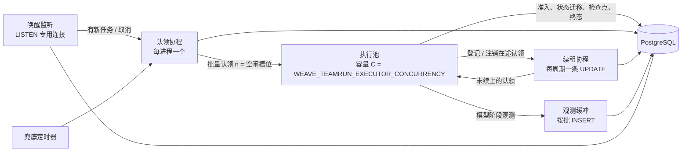

# 执行面高并发与模型网关

状态：2026-10-21 提出，待仓库负责人批准。本文只是设计稿，不含代码改动。前置步骤 P0 已合入 main（`5f00c946`）：`internal/app/api/server.go` 的 TeamRun 执行并发改由 `WEAVE_TEAMRUN_EXECUTOR_CONCURRENCY` 配置，缺省仍为 4，非法值回落缺省并告警，上限 4096。

裁定记录：2026-10-21 仓库负责人裁定决策模型成员（System One 协议，如 Jev、nimble）是普通成员，只是 provider 协议不同，provider 可不填密钥。第 6.2 节据此改写，原"成员直调快路径"撤回，第 11 节 Q1、Q2、Q3、Q7、Q8、Q11 随之关闭或作废。

依据：[分层收敛与 Loom 职责基线](2026-09-13-分层收敛与Loom职责基线.md)（控制责任契约）、[发布工作流的应用调用](2026-10-15-发布工作流的应用调用.md)（能力调用合同、取消与用量语义）、[访问模型收敛](2026-10-21-访问模型收敛.md)、[平台范围收窄整改登记 W10](../治理/2026-09-30-平台范围收窄整改登记.md#w10-删除候选与预算增长规则2026-10-08)。调用方草稿：游戏仓库 `docs/weave-决策模型成员设计.md`，本文第 6.2 节逐条合并。

## 1. 目的

一类调用方让 Weave 同时承担数百到数千个在途的纯模型成员调用。首个调用方是一款 AI 驱动的历史战略游戏：世界里有上万个智能体，大部分由游戏规则或批量决策模型处理；交给 Weave 的是各阵营的军议（`四席并行 → 汇合 → 拍板` 的已发布工作流，按 lane 串行，经 `POST /v1/capabilities/{id}/versions/{rev}/invocations` 调用），以及秒级的受限选择决策。模型额度为 deepseek-flash 并发 2500、deepseek-v4-pro 并发 500。

本文分两部分：

- **P1 执行面**：让单进程能稳定承载约 1000 个在途成员执行，让后台 SQL 不随在途数线性增长，并支持执行器多副本横向扩展。
- **P2 模型网关与决策模型 provider**：按 provider、凭据与模型控制在途数和速率，遇 429 自适应降速；provider 增加 System One 协议并允许不填密钥，决策模型成员即普通成员。

两部分都不改变 TeamRun、任务队列、取消与用量的既有语义，每步都由开关控制，缺省行为不变。业务规则仍归调用方，Weave 不解释 lane、题目或阵营的含义。

不在本文范围：远程 Runtime Host 上的成员执行、CLI 引擎、inline 能力执行器（`taskqueue.Worker` 的 `capability_invocation`，并发固定为 4，见 `cmd/weave/main.go`）的扩容；对外 SLA 承诺。

## 2. 现状与瓶颈

### 2.1 一次军议在平台里怎么走

以 `decide` 为例（4 个并行席位，1 个拍板成员），按代码阅读整理：

| 步骤 | 代码位置 | 等待点 |
| --- | --- | --- |
| 1. 准入：请求锁、调用锁、lane 锁、工作区配额锁与计数，`ReserveTx` 后 `Admit` 原子关联运行与根任务 | `internal/app/capabilities/workflow_invocation.go` `reserve`（约 366–507 行）、`workflow_invocation_quota.go`；根任务由 `internal/kernel/publicationservice/published_run.go` 约 170 行入队，`OutcomeSensitive: true` | 无 |
| 2. 根任务被某个执行循环认领 | `internal/kernel/teamrun/workers.go` `executorLoop`（462–476 行）→ `executor_queue.go` `ProcessNext`（13–36 行）→ `taskqueue/store.go` `Claim`（222–277 行，`FOR UPDATE SKIP LOCKED LIMIT 1`） | 空闲循环每 2 秒轮询一次（`workers.go` `wait`，`server.go` `temporaryTeamRunWorkerPollInterval`） |
| 3. 串行解释到 `parallel` 节点即停放，写停放意图并激活 4 个 `fanout_leg` 任务，根任务以 `CompleteClaimed` 释放 | `workflow_interpreter.go` `case machine.NodeParallel`（约 666 行）与 `buildFanoutParkPlan`；`executor_park.go` `finishParkedTask`；`fanout/workflow_coordinator.go` `workflowLegTask`（192–213 行，腿任务**不是** outcome-sensitive） | 无 |
| 4. 4 个腿任务各被一个执行循环认领并执行一个成员 | `executor_fanout.go` `processFanoutLeg` | 同步骤 2 |
| 5. 最后一条腿完成后，组被判定，但父运行的恢复任务只由汇合对账器创建 | `RecordLegCompletion`（`workflow_coordinator.go` 215–250 行）只判定不恢复；`ReconcileGroup`→`claimResume` 只由 `fanout/workflow_reconciler.go` 约 86 行调用 | 对账器每 2 秒扫描一次全部工作区 |
| 6. `fanout_resume` 任务被认领，执行 ruler，交付，写终态 | `executor_fanout.go` `processFanoutResume`；`executor_transition.go` `succeedRunning`；`executor_terminal.go` | 同步骤 2 |
| 7. 调用方轮询 `GET /v1/invocations/{id}` | 调用方 | 调用方的轮询间隔 |

一次军议因此有 6 次任务认领，平台侧最多叠加 4 次约 2 秒的轮询等待（步骤 2、4、5、6；按代码推断，待第 9 节压测确认）。

### 2.2 瓶颈清单

下表以单进程 1000 个在途成员执行、模型平均时延 10 秒为例。

| # | 现象 | 代码位置 | 1000 在途时的影响 |
| --- | --- | --- | --- |
| B1 | 每个执行循环是一个协程，一次认领一个任务并在本协程内同步执行；并发上限即循环数 | `workers.go` 401–445、462–476 行 | P0 把并发调到 1000 即启动 1000 个循环 |
| B2 | 空闲循环各自按 2 秒轮询 | `workers.go` `wait` 511–524 行 | 空闲时约 `C/2` 条认领 SQL/秒，`C=1000` 即 500 条/秒，而且是含父任务 `EXISTS` 子查询的 `UPDATE` |
| B3 | 每个在途任务一个 ticker，每 5 秒对 `weave_task_queue` 单行续租 | `executor_transition.go` `executeWithHeartbeat` 129–168 行（缺省 20 秒，`server.go` `temporaryTeamRunTaskHeartbeat` 改为 5 秒）；`taskqueue/store.go` `Heartbeat` 379–393 行 | 200 条 UPDATE/秒 |
| B4 | 运行内取消检测依赖续租失败：`Heartbeat` 的条件含 `status='running'`，任务进入 `cancel_requested` 后续租失败，执行上下文被取消；之后由 `AcknowledgeExecutionStopped` 确认停止 | `store.go` 384 行、522–536 行；`executor_queue.go` 53–70 行 | 取消检测粒度绑死在续租周期上，续租不能随意拉长 |
| B5 | 除任务租约外，每个成员尝试还有一条 Loom 尝试租约，每 30 秒在独立事务中 `SELECT … FOR UPDATE` 后续租 | `loomruntime/attempt_heartbeat.go` 92–93 行（30 秒 / TTL 120 秒）、`attempt_lease_lifecycle.go` 约 195–240 行、`attempt_lease_store.go` `RenewAttemptLease` 403 行 | 约 33 个事务/秒，每个约 4 条语句 |
| B6 | 每次模型调用同步写 5–7 条阶段观测，每条一个事务（BEGIN、INSERT、COMMIT），`event_id` 为随机 UUID；写入在模型调用路径上同步发生，`request_written` 与 `first_response_byte` 在 HTTP trace 回调里执行，每条最多等 1 秒 | `teamrun/model_activity.go` 14–48 行；`teamrun/activity.go` `Record` 41–90 行；`workflow/model_observation.go` `emit` | 100 次调用/秒时约 1500–2100 条语句/秒；连接池紧张时直接拉长模型调用 |
| B7 | 主连接池未设上限，pgx 缺省 `max(4, CPU 数)`；`pgstore` 与 `publicationservice` 用同一连接串各建一池 | `third_party/loom/pgstore/store.go` 29 行；`internal/kernel/publicationservice/service.go` 56 行；`cmd/weave/main.go` | 1000 个在途执行争 4–16 个连接；B6 的写入在此排队 |
| B8 | 认领只按 `priority DESC, created_at` 全局排序，`priority` 列从未被写入 | `store.go` 260–264 行；全仓无 `Priority:` 赋值 | 一个工作区积压即饿死其他工作区；无法区分交互与批量 |
| B9 | 准入在工作区级咨询锁下计数全部活跃调用（inline 与 workflow 两类，workflow 部分关联调用、准入、发布请求、运行与任务五张表） | `workflow_invocation_quota.go` | 活跃数越大，单工作区准入越串行；1000 级活跃时需实测 |
| B10 | 配额上限 1000：表 CHECK 与代码校验各一处 | 迁移 `0142_capability_operations.sql` 44 行（缺省 20、`BETWEEN 1 AND 1000`）；`internal/app/capabilities/operations.go` 184 行 | 无法配置到数千 |
| B11 | 每次成员执行新建 `llmrouter.Router` 与 OpenAI 客户端；客户端共用 `http.DefaultTransport`（每主机空闲连接上限 2）；无任何在途、速率限制；429 只能从错误字符串里用正则识别，且被当作不可重试，无 `Retry-After` | `workflow/runtime_host_factory.go` 210–243 行；`third_party/loom/provider/openai/openai.go` 244–246、741–743、907–911 行；`llmrouter/fallback.go` `isRetryable` 127–161 行 | 数千并发时 TLS 连接反复新建；超出 provider 额度后整批 429，军议整次失败 |
| B12 | API 与执行器同进程；停机时 `Workers.Stop` 取消全部在途执行 | `server.go` `Start` 604–625 行；`workers.go` `Stop` | 滚动重启打断在途运行；根任务是 outcome-sensitive，按代码推断会在租约过期后由 `RecoverStale` 置为 `execution lease expired; outcome reconciliation required`（待回归确认） |
| B13 | 热表无保留策略：`weave_task_queue` 终态行永久保留；活动台账由触发器禁止 UPDATE/DELETE，且外键 `ON DELETE RESTRICT` 指向运行表；现有清理只删 `loom_store` 中 90 天前的 `audit:`、`trace:` | 迁移 `0129_team_run_corrections_and_activity.sql`；`internal/app/api/retention.go` | 100 次调用/秒时活动台账日增约 4300–6000 万行 |

全仓没有 `LISTEN` / `NOTIFY`。模型调用期间不持有数据库事务或连接，这一点保持。

### 2.3 复核结论

总设计给出的 7 条现状逐条核对如下，补充与修正用粗体标出。

1. 执行循环：属实。**补充：P0 已落地；循环在本协程内同步执行任务，并发数即循环数；空闲轮询成本为 `C/2` 条/秒，P0 调大并发会同比放大空闲 SQL（B2）。另有汇合恢复只由对账器 2 秒轮询推进（2.1 步骤 5）。**
2. 续租：属实（每任务独立 ticker，`Heartbeat` 单行 UPDATE；代码缺省 20 秒，由 `server.go` 设为 5 秒）。**补充：取消检测依赖续租失败（B4）；另有第二套 Loom 尝试租约，30 秒一次事务（B5）。**
3. 模型调用期间不持有事务或连接：属实。**补充：阶段观测在调用路径上同步写库（B6），连接池紧张时会拖慢模型调用本身。**
4. 连接池：属实（另有 `cmd/weave/ops.go`、`ops_run_bundle.go` 运维命令各自建池）。**补充：同一连接串建两个池，`pool_max_conns` 会同时作用于两池，实际上限翻倍。**
5. 配额：属实。**补充：`operations.go` 184 行另有代码层 1000 上限；准入计数在工作区级锁下执行（B9）。**
6. 节点完成写检查点、活动台账、V3 audit：属实。**补充：`trace.nodes[]` 的节点状态来自 `member_started / member_completed / member_failed / member_paused` 活动事件（`workflow_invocation.go` 约 1412–1436 行），这些事件不能改为可丢失的缓冲写入；活动台账只追加，不可删。**
7. API 与执行器同进程：属实。**补充：`WEAVE_TEAMRUN_WORKERS_DISABLED` 已能让一个进程只做 API（`server.go` 610–616 行）；`weave runtime`（`daemon.Main`）是远程 Runtime Host，不是 TeamRun 执行器。**

## 3. 不变量

以下语义由现有代码与文档确立，本文的每一步都必须保持；第 9 节的验收逐条对应。

| 不变量 | 现有依据 | 本文的约束 |
| --- | --- | --- |
| 认领世代与停止确认 | 每次认领 `claim_epoch+1`；完成、失败、确认停止都写 `stopped_epoch=claim_epoch`、`stopped_worker_id`；`AcknowledgeCancelledWorkflowStoppedAtEpoch` 按精确 epoch 确认 | 批量认领、批量续租不合并 worker 身份：**每次认领仍有唯一 `worker_id`**，否则同一进程内迟到的旧执行可能以相同 worker 完成新认领 |
| 只在执行退出后确认停止 | `processClaimedWorkflowTask` 的 defer 只在本地执行汇合后调用 `AcknowledgeExecutionStopped`；`errCancellationTerminalNotSettled` 时保留认领 | 执行池只是换调度方式，不改变这段确认逻辑 |
| 租约过期不证明停止 | `RecoverStale`：outcome-sensitive 任务保留 worker 并置失败，要求停止回执 | 批量续租失败与单行续租失败等价处理 |
| TeamRun 终态唯一所有者 | 取消清扫器 `CancelGraceSweeper`（`FOR UPDATE SKIP LOCKED`）持有 `cancelled` 确认；宽限到期置 `abandoned` | 快路径的执行事实单独归属，见 6.2；不写第二份 TeamRun 终态 |
| 未知保留未知 | 10-15 文档：缺失审计、未收齐用量与已知零消耗分别表达，`usage_complete`，不能证明的 `unreported_attempts` 为 null | 缓冲写入丢失的观测在读侧显示为“未观测”，不推断为“未发出”；网关排队时被取消属于“未发出”，是已知 |
| 准入时计配额 | 两类调用在共享事务锁下计入 `max_active_invocations` | 放宽上限不改变计数语义 |
| lane 互斥与输入冻结 | 同工作区、同应用的 lane 跨能力互斥，忙时 409 `invocation_lane_active`；输入规范化后 SHA-256，同请求号不同输入、修订、通道或身份即冲突 | 快路径进入同一判断，不另立规则 |
| 取消墓碑 | 取消先到时保存停止意图，之后同一调用永不准入 | 快路径沿用 |
| 重试所有者唯一 | 分层基线第 4 节：内部恢复与平台重派不同时生效 | 网关只在一次物理尝试的授权内处理“未被受理”的 429，见 6.1 |
| 分层与预算 | `scripts/depguard.sh`、`base-depguard.sh`、`productsql`（kernel/base 不得新增对产品表的引用）、`loomimports`、`budgetguard`（四带上限等于实测，增长须写 `growth` 与 `deletion_trigger`） | 每项改动注明所在带；不新增包、不新增外部依赖，见第 10 节 |

## 4. P1 设计：执行面

### 4.1 执行器进程的形状



新增开关 `WEAVE_TEAMRUN_EXECUTOR=legacy|pooled`，缺省 `legacy`，即现有 `executorLoop`。`pooled` 同时启用 4.2–4.5 的认领、唤醒、公平和批量续租，四者共享“本进程在途认领表”，拆成多个开关反而要维护更多组合。观测写入合并另设开关（4.6），因为它改变的是落库时点。

### 4.2 认领：单认领协程与执行池

- 每进程一个认领协程，持有容量为 `C` 的信号量。槽位有空时发一条批量认领，`n = min(空闲槽位, 64)`。认领到的任务逐个交给执行池协程，协程内部仍调用现有的 `processClaimedWorkflowTask`，执行、停放、终态与停止确认的代码路径不变。
- 批量认领 SQL 保留现有过滤条件（`kind`、`identity_kind`、`available_at`、父任务仍活跃的 `EXISTS`、可选的 `workspace_id` / `run_snapshot_id` 限定），只把 `LIMIT 1` 改为 `LIMIT $n`，并让每行的 `worker_id` 唯一：

```sql
UPDATE weave_task_queue q
SET status='running',
    worker_id = $process || ':' || q.id || ':' || (q.claim_epoch + 1),
    started_at=$now, lease_expires_at=$lease, updated_at=$now,
    claim_epoch = q.claim_epoch + 1, unreported_attempts = q.unreported_attempts + 1
WHERE q.id IN (SELECT id FROM picked)        -- picked 见 4.4，FOR UPDATE SKIP LOCKED
RETURNING <taskColumns>;
```

  `$process` 为 `teamrun:<主机名>:<pid>:<启动纳秒>`。`worker_id` 由进程、任务与新 epoch 派生，每次认领唯一，现有以 `worker_id` 为条件的完成、失败、确认语句全部原样可用。
- 落点：`internal/kernel/taskqueue/store.go` 增加 `ClaimBatch`；`internal/kernel/teamrun/workers.go` 增加 pooled 循环。均在 kernel 带。

### 4.3 唤醒：LISTEN/NOTIFY，轮询兜底

- 入队方在入队事务内执行 `SELECT pg_notify('weave_task_ready', kind)`，通知在提交后送达，回滚则不送达。覆盖的写入点：`EnqueueTx`、`requeueClaimed`、`RecoverStale` 的重新入队、汇合激活腿任务。只有本进程配置为 `pooled` 时才发通知；混合部署下未收到通知的执行器仍靠兜底轮询，正确性不受影响，只是时延回到现状。
- 每个执行器进程用一条**专用直连**连接 `LISTEN weave_task_ready` 与 `weave_task_cancel`（4.5）。收到通知即唤醒认领协程；同时保留兜底定时器（缺省 2 秒），连接断开期间退化为轮询，重连后立即补认领一次。`available_at` 在未来的延迟任务由认领协程按最近的 `available_at` 设定下一次定时。
- 汇合恢复：`RecordLegCompletion` 判定组完成并提交后，在 pooled 模式下同进程内立即调用一次 `ReconcileGroup`（尽力而为，失败只记日志），对账器保留为兜底。这样省掉 2.1 步骤 5 的轮询等待，不改变恢复的判定与 fencing。落点 `internal/kernel/teamrun`（适配层调用）与 `internal/kernel/fanout`，kernel 带。
- 风险：PostgreSQL 中发出 NOTIFY 的事务在提交时要取一把全库通知队列锁，入队速率很高时会串行化提交。目标负载下每秒数十到数百次入队，预计可接受；压测（第 9 节）单列“通知开/关”对比提交时延。若成为瓶颈，退路是关闭通知、把兜底间隔缩到 200 毫秒，此时一个进程的空闲认领 SQL 也只有 5 条/秒。

### 4.4 公平

- 工作区之间：认领时先找出有排队任务的工作区，对每个工作区取前 `k` 个，再按“工作区内名次、优先级、创建时间”交错取 `n` 个加锁：

```sql
WITH ws AS (
  SELECT DISTINCT workspace_id FROM weave_task_queue
  WHERE status='queued' AND kind=$kind AND identity_kind=$identity AND available_at <= $now
    AND workspace_id <> ALL($saturated)
), head AS (
  SELECT h.* FROM ws, LATERAL (
    SELECT id, workspace_id, priority, created_at,
           row_number() OVER (ORDER BY priority DESC, created_at) AS rank_in_ws
    FROM weave_task_queue
    WHERE workspace_id = ws.workspace_id AND status='queued' AND kind=$kind
      AND identity_kind=$identity AND available_at <= $now  /* 及父任务 EXISTS 条件 */
    ORDER BY priority DESC, created_at LIMIT $k) h
), picked AS (
  SELECT q.id FROM weave_task_queue q JOIN head USING (id)
  WHERE q.status='queued'
  ORDER BY head.rank_in_ws, head.priority DESC, head.created_at
  LIMIT $n FOR UPDATE OF q SKIP LOCKED
)
…（4.2 的 UPDATE）
```

  `$saturated` 是本进程内在途数已达 `C × WEAVE_TEAMRUN_WORKSPACE_SHARE`（缺省 1.0，即不限）的工作区。配合部分索引（4.8）。
- 工作区之内：任务的 `priority` 列开始使用，取值来自调用的优先级（6.3），根任务、腿任务与恢复任务继承所属运行的优先级。lane 本身已保证每条 lane 至多一个在途调用，所以一个阵营无法用同一 lane 灌满队列；lane 之间的模型额度竞争在网关里按公平键处理（6.1、6.3）。
- 单工作区部署（游戏即如此）只用到优先级与网关公平，工作区轮转不起作用，也没有额外成本。

### 4.5 批量续租与取消识别

- 续租协程每周期对本进程全部在途认领发一条语句：

```sql
UPDATE weave_task_queue q
SET lease_expires_at=$lease, updated_at=$now
FROM unnest($ids::text[], $workers::text[]) AS h(id, worker_id)
WHERE q.id=h.id AND q.worker_id=h.worker_id
  AND q.status='running' AND q.lease_expires_at >= $now
RETURNING q.id;
```

  条件与现有 `Heartbeat` 逐项相同，只是从单行变成一批。未出现在 `RETURNING` 中的认领，与今天单行续租失败等价：对应执行上下文以 `errTaskLeaseLost` 取消，后续停止确认走原 defer。为了观测，仅当有未续上的认领时再查一次 `SELECT id, status, worker_id, claim_epoch … WHERE id = ANY($missing)`，把原因分为“已请求取消”“被他人认领或已过期”，只记指标，不改变处理。
- 取消通知：`CancelRunTasksTx`、`RequestCancelTask` 在把任务置为 `cancel_requested` 的同一事务里 `pg_notify('weave_task_cancel', run_snapshot_id)`。执行器按快照 ID 找到本进程的在途认领，立即走与“续租未续上”相同的取消路径。通知只是提前唤醒；最终仍以下一次批量续租的结果为准，不会因丢失通知而漏取消。
- 续租周期：取消检测有了通知之后，续租只负责租约，周期可以与取消检测解耦。本文仍保持 5 秒周期、60 秒 TTL（`cmd/weave/main.go` 295 行）不变；是否把周期放宽到 15 秒以减少行版本翻动，待压测后裁决（第 11 节 Q4）。
- Loom 尝试租约：第二步把 `weave_run_attempt_leases` 也按进程批量续租，条件逐项沿用 `RenewAttemptLease`（`state='active'`、精确 generation 与 attempt_id、数据库时钟），未续上的尝试按 `ErrAttemptLeaseHeartbeatOwnerLost` 处理。现有逐尝试续租中的测试钩子（`runAttemptLeaseHeartbeatHook`）保留在 legacy 路径。
- 兼容性：`claim_epoch`、`stopped_epoch`、`stopped_worker_id` 的写入点全部不变；`AcknowledgeCancelledWorkflowStoppedAtEpoch` 依赖的精确 worker 与 epoch 仍来自认领返回值；取消清扫器只读数据库事实，不感知续租方式。
- 落点：`taskqueue/store.go` 增加 `RenewBatch`，`loomruntime/attempt_lease_store.go` 增加批量续租，`teamrun` 持有续租协程。均在 kernel 带。

### 4.6 写入合并

原则：凡是读侧据以判定状态、恢复据以继续、取消据以确认、计费据以结算的写入，保持同步；只做诊断用途、缺失时读侧能如实显示“未观测”的写入，才允许缓冲。

| 写入 | 方式 | 理由 |
| --- | --- | --- |
| 准入、请求关联、取消意图与墓碑 | 同步 | 幂等、lane、配额与取消先到的判定依据 |
| 任务认领、完成、失败、停止确认；TeamRun 状态迁移 | 同步 | 租约与终态 fencing |
| 工作流检查点、Loom 成员 journal 与检查点、汇合意图与腿完成 | 同步 | 恢复依据 |
| 阶段输出、交付物、产物来源 | 同步 | 结果与证据 |
| 尝试租约准入与关闭、终态 marker、V3 audit | 同步 | 用量与终态证据 |
| `member_started / completed / failed / paused` 活动事件 | 同步 | `trace.nodes[]` 的状态来源，丢失会把已执行节点显示成 `pending` |
| 模型调用阶段观测 `model_*` | **可缓冲** | 只用于诊断，已是尽力而为（失败只告警） |
| 工具观测 `tool_started / tool_completed` | 可缓冲 | 同上；纯模型成员不产生 |

缓冲规则（`WEAVE_TEAMRUN_OBSERVATION_WRITES=sync|buffered`，缺省 `sync`）：

1. 进程内有界缓冲，每 200 毫秒或满 256 条即以一条多行 `INSERT … ON CONFLICT (workspace_id, run_id, event_id) DO NOTHING` 落库。
2. `event_id` 改为确定值 `model:<model_call_id>:<phase>`，重复冲刷幂等。这个改动在 `sync` 模式下同样生效，独立可验。
3. **冲刷屏障**：同一运行写 `member_*` 事件、检查点、终态或停止确认之前，先冲刷该运行的待写观测并等待完成。读侧因此看到的顺序与今天一致：阶段观测在成员完成之前。
4. 缓冲满时不阻塞模型调用，丢弃并计数；在下一次屏障处为该运行补写一条 `model_observation_gap` 事件，记录丢弃条数。缺口是显式的“未观测”，不是“未发生”。
5. 进程崩溃会丢失最近一个冲刷周期内的观测，且来不及写缺口事件。读侧本来就不从缺少阶段推断“请求未发出”（调用视图只投影 `member_*` 事件），因此语义上仍是“未观测”。

对 10-15 文档“回归必须证明在调用返回前阶段已经落地”的影响：`buffered` 模式下改为“成员节点收口（完成、失败、取消确认）之前阶段已经落地；模型调用挂起时阶段在一个冲刷周期内落地；进程崩溃时至多丢失一个周期”。挂起正是当时要诊断的情形，冲刷协程不受挂起的模型调用影响。这一条改写需要仓库负责人批准（第 11 节 Q5）。

另一处可减行数的改动：把同一次调用的 `request_written`、`first_response_byte`、`first_chunk` 合并进 `completed / failed / cancelled` 那一行的 `detail`（各阶段相对毫秒）；只有调用超过 `WEAVE_MODEL_OBSERVATION_SLOW_MS`（缺省 5000）仍未结束时才单独写出已到达的阶段。每次调用从 5–7 行降到 2 行（`started` 与收口行），挂起诊断不受影响。是否采用见第 11 节 Q5。

落点：`teamrun/activity.go`、`model_activity.go`，kernel 带；不改表结构。

### 4.7 执行器角色与横向扩展

- 同一二进制新增子命令 `weave executor`：读取同一组配置，只装配并启动 TeamRun 执行器、汇合对账器、取消与定时清扫、`RecoverStale`，不监听公开 API 端口；可选 `WEAVE_EXECUTOR_ADMIN_ADDR`（缺省不开）只在回环地址提供健康检查与计数器。迁移仍由 server 角色执行（迁移本身已用事务级咨询锁，重复执行也安全）。
- 角色组合：`weave`（缺省）= API + 执行器，与今天相同；`weave` + `WEAVE_TEAMRUN_WORKERS_DISABLED=true` = 仅 API（已有）；`weave executor` = 仅执行器。多个执行器副本共享同一队列，靠 `SKIP LOCKED` 与唯一 `worker_id` 互不干扰；现有清扫器已用 `FOR UPDATE SKIP LOCKED` 或幂等键（例如 `teamrun/store.go` `listCancelRequestsTx`），多副本并跑安全，压测中逐个核对。
- 优雅排空：`WEAVE_TEAMRUN_DRAIN_TIMEOUT`（缺省 0，即现状：立即取消在途执行）。设为正值时，收到 SIGTERM 先停止认领，等待在途执行在时限内自然结束，期间继续批量续租；时限到达后才取消剩余执行，剩余部分仍走现有停止确认与 `RecoverStale` 语义。滚动发布的副作用由此可控。
- 与 Runtime Host 的关系：

| | TeamRun 执行器（本节） | Runtime Host（`weave runtime`，`internal/app/daemon`） |
| --- | --- | --- |
| 身份 | 控制平面进程，直连数据库，与 server 同信任级别 | 执行位置，持运行时令牌，经运行时协议与平台通信，不连数据库 |
| 执行什么 | 平台进程内的 Loom 成员与工作流解释 | 绑定到该运行时的 `engine_exec` 任务（CLI 引擎或远程 Loom） |
| 扩展方式 | 多副本共享 `weave_task_queue` | 按运行时 ID 认领，`claimEngineTask` 先锁运行时行 |

  两者不合并。理想架构第 8 节中执行 Host 的独立仓职责不受影响；本节只是把已在 server 进程里的执行器拆成可单独部署的角色。
- 落点：`cmd/weave/main.go`（不计入四带预算）；`internal/app/api/server.go` 增加“只启动执行器”的入口，复用 `ConfigureTeamRunWorkers`，app 带。

### 4.8 数据库

**连接池。** 不改代码即可经连接串配置：`DATABASE_URL=…?pool_max_conns=48&pool_min_conns=8`。由于 `pgstore` 与 `publicationservice` 各建一池（B7），单进程实际可用连接数是该值的两倍；作为可选小改动，让 `publicationservice` 复用主池，连接数规划更直观（kernel 带，约 20 行）。规划公式：`max_connections ≥ Σ进程 (2 × pool_max_conns + 1 条 LISTEN) + 运维余量`。建议起点：执行器进程 `pool_max_conns=32~64`，API 进程 16~32；以压测中连接获取等待（pgxpool `AcquireDuration`、`EmptyAcquireCount`）为准调整。

**pgbouncer。**

| 用法 | 事务池模式下 | 处理 |
| --- | --- | --- |
| 事务级咨询锁 `pg_advisory_xact_lock` | 兼容 | 全仓只用事务级锁（迁移器亦然），无会话级锁 |
| `set_config(…, true)` | 兼容 | 只在迁移中使用，事务内有效 |
| `NOTIFY`（发送） | 兼容 | 随事务提交 |
| `LISTEN`（接收） | **不兼容**：会话级状态，事务结束后连接可能被别的客户端复用 | 监听连接走 `WEAVE_DATABASE_LISTEN_URL`（缺省等于 `DATABASE_URL`），部署 pgbouncer 时指向 PostgreSQL 直连或会话池 |
| pgx 缺省的预备语句缓存 | 需 pgbouncer ≥ 1.21 且 `max_prepared_statements > 0` | 否则在连接串加 `default_query_exec_mode=exec` |

**热表与索引。** 热表为 `weave_task_queue`、`weave_run_attempt_leases`、`weave_team_runs`、`weave_team_run_activity_events`、汇合表、`loom_store`（检查点与 audit）、交付物表。新增迁移：

- 认领用部分索引 `(kind, identity_kind, workspace_id, priority DESC, created_at) WHERE status='queued'`；
- `weave_task_queue`、`weave_run_attempt_leases` 设 `fillfactor=80`，让只改 `lease_expires_at / updated_at` 的续租走 HOT 更新（两列都不在索引中，迁移前核对）；
- 用 `EXPLAIN (ANALYZE, BUFFERS)` 核对 `RunExecutionsStoppedTx`、`cancelRunTasks`、`RecoverStale` 与配额计数的计划，缺索引的补上。

迁移器在事务内执行，`CREATE INDEX CONCURRENTLY` 不可用；大表上的建索引需要运维窗口，或由运维脚本先行建好、迁移用 `IF NOT EXISTS` 跳过。

**分区与保留。** 本文不自行决定，列为第 11 节 Q6。可选项：

1. 活动台账按 `occurred_at` 月分区，以分离并删除整月分区实现保留。这与“只追加”触发器的本意是否相容（触发器禁止的是改写单行，分区删除是保留策略）须由负责人确认；主键需加入 `occurred_at`。
2. `weave_task_queue` 终态行超过 N 天后归档或删除。调用视图从任务与运行行投影状态，删除后的历史调用须明确返回“已过保留期”，不能显示成未知状态之外的任何确定状态。
3. 先只做 4.6 的“每次调用 2 行”，行数降到约三分之一，推迟分区。

### 4.9 配额

- 新迁移把 `max_active_invocations` 的 CHECK 改为 `BETWEEN 1 AND 20000`，缺省值仍为 20；`internal/app/capabilities/operations.go` 184 行的代码校验同步改为 20000；`max_steps_per_invocation` 不变。app 带与 base 带（迁移文件）。
- 计数语义不变。若压测显示 1000 级活跃时准入计数 p95 超过 5 毫秒，再考虑按调用表活跃状态加部分索引；不引入独立计数器表，避免出现第二个需要对账的事实。
- 快路径是否单列配额见 6.2 与第 11 节 Q8。

### 4.10 容量模型

符号：`N` 单进程在途成员执行数；`C` 执行池容量；`L` 模型平均时延；`λ = N / L` 单进程每秒完成的成员执行数；`h` 任务续租周期（5 秒）；`a` 尝试租约周期（30 秒）；`p` 空闲轮询周期（2 秒）；`R` 执行器进程数；`k_w` 每次成员执行的“工作 SQL”条数（认领、journal、检查点、终态等，**须实测**，第 9 节用 `pg_stat_statements` 统计）；`k_o` 每次模型调用的观测语句数。

后台 SQL（与完成量无关、只与在途或池容量有关）：

| | 现状（legacy） | pooled |
| --- | --- | --- |
| 任务续租 | `N / h` | `1 / h`（另加未续上时的 1 条分类查询） |
| 尝试租约 | `≈ 4N / a` | `1 / a` |
| 空闲认领 | `(C − 忙碌循环数) / p` | `1 / p`（兜底；有通知时更少） |
| 合计，`N = C = 1000` | `200 + 133 + 0 ≈ 333 条/秒`；全空闲时 `500 条/秒` | `0.2 + 0.03 + 0.5 ≈ 0.7 条/秒`，与 `N`、`C` 无关 |

工作 SQL（与完成量成正比）：`λ × (k_w + k_o)`。现状 `k_o ≈ 3 × 阶段数 = 15~21`；缓冲后约为 `3f / λ`（`f` 为每秒冲刷次数，约 5），`λ = 100` 时每次调用约 0.15 条。认领在忙碌时为每批一条。

例：单进程 `N = 1000`、`L = 10 秒`，`λ = 100/秒`。续租 SQL 从 200 条/秒降到 0.2 条/秒；观测语句从约 1800 条/秒降到约 15 条/秒；剩余负载为 `100 × k_w`。连接需求按 Little 定律估计：`工作 SQL/秒 × 平均语句耗时`，再按突发留 3–5 倍余量。

多进程：后台 SQL 为 `R × 0.7` 条/秒；工作 SQL 为 `Σλ × k_w`；模型并发受网关全局份额约束（6.1）。按当前额度，有效的全局在途上限约为 deepseek-flash 2500 + deepseek-v4-pro 500。建议起点为 3 个执行器、各 `C = 1000`，各进程 flash 份额 833、pro 份额 166；执行池容量略大于网关份额，让排队发生在内存里的网关，而不是数据库里的队列。

目标（第 9 节的通过条件）：

| 指标 | 现状（推断） | 目标 |
| --- | --- | --- |
| 单进程后台 SQL | 333–500 条/秒 | ≤ 1 条/秒 |
| 入队提交 → 认领，p95 | ≤ 2 秒 | ≤ 100 毫秒（有通知）/ ≤ 2 秒（兜底） |
| 一次军议的平台开销（墙钟减去模型时间），p95 | 约 4–8 秒 | ≤ 500 毫秒 |
| 取消请求 → TeamRun `cancelled`，p95，模型可及时停止时 | 约 5–7 秒 | ≤ 2 秒（有通知） |
| 稳态误报租约丢失 | 未测 | 0 |
| 单进程稳定在途 | 未测 | 1000，DB CPU 与连接等待不随 `N` 线性上升 |

## 5. P1 的合约变化

- 公开 API：无变化。
- 部署配置（全部可选，缺省即现状）：`WEAVE_TEAMRUN_EXECUTOR`、`WEAVE_TEAMRUN_WORKSPACE_SHARE`、`WEAVE_TEAMRUN_OBSERVATION_WRITES`、`WEAVE_MODEL_OBSERVATION_SLOW_MS`、`WEAVE_TEAMRUN_DRAIN_TIMEOUT`、`WEAVE_DATABASE_LISTEN_URL`、`WEAVE_EXECUTOR_ADMIN_ADDR`；子命令 `weave executor`。`server.go` 中“Deployment policy pending (OQ-5)”的临时常量保留，不在本文转为公开配置。
- 内部接口：`taskqueue.Store` 增加 `ClaimBatch`、`RenewBatch`；入队与取消路径可选发通知；`teamrun.Workers` 增加 pooled 模式；活动事件 `event_id` 变为确定值；新增活动事件种类 `model_observation_gap`。
- 数据：`weave_task_queue` 的 `priority` 开始写入；索引与 fillfactor 迁移；配额上限迁移。表结构无删除。

## 6. P2 设计：模型网关与快路径

### 6.1 模型网关

**落点。** `internal/kernel/llmrouter`（kernel 带），新文件实现 `Gateway`，不新增包。网关是进程单例，由组合根（`server.go` `ConfigureTeamRunWorkers` 与系统 provider 装配处）创建并注入：

- `workflow.NewRuntimeHostFactory` 增加带网关的构造选项，`buildRuntimeHostsWithLLM` 每次仍新建 `Router`，但注册的 provider 客户端外包一层网关包装；
- 系统 `Router` 与 `Resolver` 的 Chat / Stream 同样经过网关；
- 6.2 的快路径直接使用网关。

覆盖不到的部分写明：远程 Runtime Host 经 `ResolveProviderConfiguration` 取得 provider 配置后自行调用（`internal/app/api/local_runtime.go` 94 行），CLI 引擎自管推理，这两类不受本进程网关约束，额度规划时需另留余量。

**限流键。** `(provider_id, 凭据引用, 模型)`。凭据引用取冻结引用的 scope 与 service_id，不取密钥本身，也不把密钥作为 map 键。同一引用下的多次成员执行共享一组限制。

**三道闸。**

1. 在途上限：硬上限信号量，配置值为 `max_in_flight × share`。
2. RPM 令牌桶。
3. TPM 令牌桶：发送前按请求体字节数与 `max_output_tokens` 估算并预扣，收到 usage 后按实际值多退少补；provider 未报 usage 时保留估算，只影响网关内部记账，不进入用量事实。

令牌桶自行实现（约百行），不引入 `golang.org/x/time/rate`，kernel 的外部依赖白名单不变。

**自适应降速（AIMD）。** 在途上限之下维护“当前有效并发” `W`。收到 429、503、529 或明确的过载错误时，`W = max(W_min, ⌊0.7 W⌋)`，并暂停本键放行 `Retry-After`（无该头时用退避值）；在一个观察窗口（缺省 10 秒）内无拥塞信号且有排队时，`W += 1`，上限为配置值。超时只在窗口内超时率超过阈值（缺省 20%）时才算拥塞信号，以免慢请求被误判。

**429 的处理。** 429 说明 provider 未受理这次请求，结果是已知的，不属于“结果未知”。网关可以在**同一次物理尝试的期限内**把它重新排队，最多 3 次，并遵守 `Retry-After`。这属于成员执行器“在本次授权内处理内部失败”，不扩大 TeamRun 的重试次数；上层的 `FallbackLLM` 本来就把 429 当作不可重试，不会叠加重试。纯模型工作流成员没有备用模型（`capability/workflow.go` `validatePureModelBundle`），不受“429 切换备用模型”行为影响。是否默认开启见第 11 节 Q9；未开启时 429 原样上抛，与现状一致。

**排队、优先级与公平。** 被闸挡住的请求在内存中排队，等待受请求上下文的期限与取消约束；排队中被取消的请求没有发出，记为“未发出”，不增加未回报尝试。出队顺序：先按优先级类（`interactive > normal > batch`，6.3），同类内按公平键做差额轮转（DRR），同一公平键内先进先出。公平键与优先级随执行上下文从任务带入（6.3），网关不读产品表。

**错误分类与连接。** 现状只能用正则从错误字符串识别状态码（`fallback.go`）。在 Loom 上游增加两项能力：带状态码与 `Retry-After` 的类型化错误、注入 `http.RoundTripper` 的选项。之后网关为每个 provider 主机持有专用 Transport，`MaxConnsPerHost` 与 `MaxIdleConnsPerHost` 取在途上限，消除 `DefaultTransport` 每主机 2 条空闲连接导致的连接反复新建。上游发布并同步到 `third_party/loom` 之前，网关退回正则分类，Transport 保持现状。`third_party/loom` 必须与上游发布逐字节一致，因此这两项须先在独立 Loom 仓合入。

**用量与“未知”。** 网关不是用量账本。用量事实仍由成员执行（Loom 用量累计、V3 audit）或快路径执行行（6.2）持有，`usage_complete` 与 `unreported_attempts` 的语义不变。网关只补充诊断信息：模型观测的收口行增加 `gateway_wait_ms`，固定错误分类增加 `rate_limited` 与 `gateway_deadline`（排队期间期限到达）。

**多副本份额。** 第一版用静态份额：每个进程按配置 `share`（如 1/3）取全局上限的一部分。AIMD 能吸收份额配置的误差。跨进程的动态份额（例如在数据库中按批租用配额槽位）留作后续，第 11 节 Q10。

**多凭据池。** 本轮不做。现有合同要求主模型凭据是精确冻结的 `workspace_service` 引用，运行时换用另一把密钥会违反冻结。将来若需要，应把“凭据池”本身做成一种 workspace_service 凭据，冻结引用指向池，解析时由网关在池内选择成员密钥，用量按成员密钥归集；限流键届时扩展为池成员。

**配置。** `WEAVE_MODEL_GATEWAY_CONFIG` 指向 JSON 文件，按 `provider_id + model` 配置 `max_in_flight`、`rpm`、`tpm`、`share`、AIMD 参数与 429 重排开关。未配置时网关不生效，行为与现状一致。这些是部署容量策略，不进入冻结的 provider 修订，不改变修订哈希。

### 6.2 决策模型：普通成员，另一种 provider 协议

**裁定。** 2026-10-21 仓库负责人裁定：决策模型成员（TypeSafe Jev、本机 Ollama 上的 nimble 等 System One 协议模型）就是普通成员，不区别对待。它仍是 Loom 纯模型成员，在普通团队、普通工作流与 TeamRun 中执行，只是所用模型由一个协议为 `systemone` 的 provider 提供；provider 可以不填密钥。本节此前的"成员直调快路径"——不建 TeamRun 的同步执行、kernel 执行表 `weave_direct_executions`、`systemone` 成员引擎、单节点团队约束——全部撤回。

**做法。**

- provider 增加 `protocol`：`openai`（缺省，即现状）或 `systemone`，随凭据修订持久化并进入修订哈希。`systemone` provider 在 `llmrouter` 注册为一个实现 `contract.LLM` 的客户端，把成员的一次模型调用映射为一次 `POST {base_url}/v1/systemone`：
  - 最后一条 user 消息须是含 `questions`（System One 线格式）的 JSON，`state` 可选；成员的系统提示词拼到每道题的 instructions 之前；
  - 助手输出是 answers 对象的 JSON 文本，由成员的 `output_schema` 照常校验；
  - 带工具的请求直接报错（决策模型不调用工具）；
  - 协议校验：答案键集合等于题目键集合，choice 属于 criteria 的键，score 在 `[0, n-1]`，noul 与 confidence 在 `[0, 1]`，拒绝 NaN 与 Inf。
- 密钥可选：provider、凭据修订与认领只要求 base URL；密钥为空时不发 Authorization。原 Q11 由此关闭，不需要"无凭据修订"之类的新概念。
- 管理控制台新增"模型"页：新增、编辑、删除 provider，选择协议，密钥可留空、可清空；成员编辑器照旧从模型目录给成员改选模型。
- 成员引擎、freezer、compiler、TeamRun、能力调用合同、发布前试运行规则都不变。决策模型成员与 DeepSeek 成员可以出现在同一个团队、同一张图里。

实施在分支 `feat/provider-protocols`，同日另有一页说明。

**时延。** 决策模型本身每次 0.1–0.4 秒，单成员调用的耗时主要来自 TeamRun 的平台开销（入队、认领轮询、续租、汇合恢复）。不另开执行路径，由 P1 降低开销：批量认领与 NOTIFY 唤醒消除认领轮询的 0–2 秒等待；最后一条腿完成后在进程内立即恢复父运行，消除汇合对账的 0–2 秒等待。P1 验收增加一项：单成员团队的平台开销 p95（不含模型时间）不超过 300 毫秒（9.1 节 S9）。P1 之后仍达不到时另立文件讨论，本文不预设其他执行路径。

### 6.3 优先级与公平

- 请求字段：能力调用请求增加可选的 `priority`（`interactive` / `normal` / `batch`，缺省 `normal`）与 `fairness_key`（≤ 64 字节，缺省等于 `lane`；没有 lane 时为调用 ID）。两者在准入时随调用冻结，计入幂等比对。
- 授权上限：应用增加 `max_priority`（缺省 `normal`，由工作区管理员设置）。请求高于上限即 400，不静默降级。
- 传递：准入时写入 `publication.PublishedRunRequest` 的调度提示，落到根任务的 `priority` 列与新列 `fairness_key`；腿任务与恢复任务从所属运行继承；执行时放入上下文，供网关读取。kernel 只读任务上的这两个值，不读产品表。
- 同一工作区内多个阵营 lane 之间：lane 串行使每条 lane 至多一个在途调用，即至多 4 个并行席位，单个阵营无法独占执行池。provider 额度上的竞争由网关的差额轮转处理，缺省每条 lane 份额相等。调用方若希望按阵营均分而不是按 lane 均分，把 `fairness_key` 设为阵营标识即可；Weave 不解释它。
- 层级之间：调用方可把需要快速返回的层设为 `interactive`，后台层设为 `batch`。优先级只影响排队顺序，不抢占已在执行的调用。

## 7. P2 的合约变化

- 公开 API：能力定义与调用视图不变；调用请求可选 `priority`、`fairness_key`；应用增加 `max_priority`；provider 增加 `protocol`，`api_key` 改为可选。全部为新增或放宽，现有字段含义不变（满足开发者契约第 7 节）。
- 成员：不变，没有新引擎。
- 部署配置：`WEAVE_MODEL_GATEWAY_CONFIG`。
- 上游依赖：Loom 的类型化 HTTP 错误与 Transport 注入。

## 8. 迁移

迁移号按实施时的末号顺延；`0196` 已由 provider 协议占用。

| 迁移 | 内容 | 阶段 |
| --- | --- | --- |
| `0197_capability_quota_limits.sql` | `max_active_invocations` 的 CHECK 改为 `1–20000`，缺省 20 不变 | P1 |
| `0198_task_queue_scheduling.sql` | 认领部分索引；`fairness_key` 列（可空）；`weave_task_queue`、`weave_run_attempt_leases` 的 `fillfactor=80` | P1 |
| `0196_provider_protocol.sql` | provider 凭据修订增加 `protocol`（缺省 `openai`），密钥可空 | P2（已实施） |
| `0199_app_max_priority.sql` | 应用 `max_priority` | P2 |
| 待定 | 活动台账分区与保留、任务队列保留 | 视 Q6 |

没有数据转换，也不删除表或列。已有运行、调用、用量与台账保持原样；新列对旧行取缺省值（`protocol='openai'`、`fairness_key` 为空、`priority=0`）。

**分阶段与回退。** 每一步单独提交、单独验证。开关关闭即回到上一步的行为，不需要回滚数据。

| 步 | 内容 | 开关 / 入口 | 缺省 | 回退 |
| --- | --- | --- | --- | --- |
| P0 | 执行并发可配（已完成） | `WEAVE_TEAMRUN_EXECUTOR_CONCURRENCY` | 4 | 不设即回到 4 |
| P1-1 | 计数器与压测工具（只观测），确定性 `event_id` | 无 | — | — |
| P1-2 | 单认领协程、执行池、批量续租、通知唤醒、汇合即时恢复、工作区公平 | `WEAVE_TEAMRUN_EXECUTOR=pooled` | `legacy` | 改回 `legacy` 后重启；在途认领仍由 TTL 与 `RecoverStale` 按原语义处理 |
| P1-3 | 尝试租约批量续租 | 随 `pooled` | 关 | 同上 |
| P1-4 | 观测写入合并（及每次调用 2 行，若批准） | `WEAVE_TEAMRUN_OBSERVATION_WRITES=buffered` | `sync` | 改回 `sync` |
| P1-5 | `weave executor` 角色与优雅排空 | 子命令；`WEAVE_TEAMRUN_DRAIN_TIMEOUT` | 不启用；0 | 停用执行器副本，恢复一体进程 |
| P1-6 | 索引、fillfactor、配额上限迁移，连接池与 pgbouncer 文档 | 迁移 | — | 迁移只放宽或增加，可保留 |
| P2-1 | 模型网关：在途闸与排队、优先级与公平 | `WEAVE_MODEL_GATEWAY_CONFIG` | 未配置即关闭 | 删除配置 |
| P2-2 | 令牌桶、AIMD、429 重排 | 同上，按键配置 | 关 | 同上 |
| P2-3 | Loom 上游：类型化错误、Transport 注入；同步 `third_party/loom` | 无 | — | 回退到上一版 Loom 同步点 |
| P2-4 | 调度提示 `priority` / `fairness_key` 与应用 `max_priority` | 请求字段 | `normal` / lane | 不传即缺省 |
| P2-5 | provider 协议 `systemone` 与可选密钥；管理控制台"模型"页 | 新增 `systemone` provider | 无此类 provider 即无变化 | 删除该 provider，成员改选模型 |

调用方切换（游戏仓库）：P2-5 上线后，把 field 层从直连 nimble 换成一支普通团队（含一位模型为 nimble 的成员）及其能力修订，请求体原样放进 `input`；切换后删除游戏侧直连代码，不保留两条路径。这一步在调用方仓库完成，不在本文实施范围。

## 9. 验证

### 9.1 压测方案

- **模型桩**：本机 HTTP 服务，同时提供 OpenAI 兼容的 chat completions（流式与非流式）和 `/v1/systemone`。可配置时延分布（固定、对数正态、双峰与长尾）、首字节时延、429 比例及 `Retry-After`、503、超时、截断流、“挂起直到客户端取消”、是否回报 usage；内置并发计数器，用于断言网关上限。放在 `tools/loadtest/`，不在四带之内，也不进生产二进制。
- **数据库**：真实 PostgreSQL，开启 `pg_stat_statements`，按语句指纹统计 SQL/秒；记录 `pg_stat_activity` 的连接数与等待事件、提交时延、WAL 量与表膨胀。
- **驱动**：经真实 HTTP 调用能力接口，使用与游戏相同形状的 `decide` 工作流（4 席并行 + ruler）与单成员 `consult`，lane 数可调。
- **场景**：

| # | 场景 | 重点 |
| --- | --- | --- |
| S1 | 单进程稳态，在途 250 / 500 / 1000，模型时延 10 秒 | 后台 SQL、认领时延、DB CPU、连接等待 |
| S2 | 1 秒内准入 500 次军议 | 准入串行化（B9）、认领突发 |
| S3 | 3 个执行器副本，全局在途 3000，网关 flash 2500 / pro 500 | 份额、认领冲突、清扫器并跑 |
| S4 | 运行中取消 10% 的调用；另测模型桩挂起至取消 | 取消确认时延；未退出的模型不能被报告为已停止 |
| S5 | 稳态中 `kill -9` 一个执行器 | 认领世代、停止回执、`RecoverStale`、无重复终态 |
| S6 | 模型桩返回 30% 的 429 并带 `Retry-After` | AIMD 轨迹、429 重排次数、军议失败率 |
| S7 | 两个工作区，一个灌入 5000 个任务 | 另一个的认领时延 |
| S8 | `batch` 积压时提交 `interactive` | 网关排队时间 |
| S9 | 单成员团队（含 `systemone` 成员）平台开销 p50 / p95，不含模型时间 | p95 ≤ 300 毫秒 |
| S10 | 设置排空时限后滚动重启 | 在途运行完成率 |
| S11 | 通知开 / 关对比 | 提交时延与 NOTIFY 锁竞争（4.3） |

- **指标**：入队提交 → 认领时延，队列深度，在途数，SQL/秒（按续租、认领、观测、工作分类），续租未续上次数及原因分布（稳态误报应为 0），取消请求 → 任务停止确认 → TeamRun `cancelled` 的时延，一次军议的平台开销，连接获取等待，网关排队时延、当前 `W`、429 比例，观测丢弃数。
- **通过条件**：4.10 的目标表，加上本节 S4、S5、S9 的不变量断言全部成立。结果记录到 `docs/验收/`，写明机器、PostgreSQL 版本、开关取值与原始数据位置。

### 9.2 与现有回归的关系

- 现有全套测试在开关的两个取值下都必须通过：缺省值即现在的 CI；另加一组以 `pooled`、`buffered`、网关开启运行的 CI 任务。重点套件：`teamrun/executor_process_next_test.go`、`cancellation_lifecycle_pg_test.go`、`runtime_stop_test.go`、`stage_retry_race_test.go`、`workflow_runtime_observation_test.go`、`model_activity_test.go`、`activity_recovery_test.go`、`member_recovery_pg_test.go`、`loomruntime` 的 `member_*_pg_test.go`、`fanout/workflow_coordinator_test.go`、`workflow_reconciler_test.go`、`capabilities/workflow_invocation_*`、`api/capability_workflow_model_pg_test.go`、`api/retired_routes_test.go`。
- 新增回归（真实 PostgreSQL，受控模型 HTTP）：批量认领的 `worker_id` 唯一性与旧执行不能完成新认领；批量续租在取消、他人认领、过期三种情况下与单行续租等价；通知丢失时由兜底轮询与下次续租补上；冲刷屏障保证阶段观测先于 `member_completed`；缺口事件；排空；`systemone` provider 的请求与答案校验、空密钥不发 Authorization、改协议即新修订；网关的上限、优先级、DRR、AIMD 与排队中取消。认领协程、续租协程、观测缓冲、网关一律跑 `-race`。
- 治理门禁：`go build ./...`、`go vet ./...`、`make depguard`（含 `productsql`、`loomimports`）、`base-depguard`、`productguard`、`budgetguard`、`tools/tests`、`make compose-check`。
- 压测不进入 `make test`，以 `WEAVE_LOADTEST=1` 显式运行。真实模型整局验收由调用方另行记录，不以工程压测代替。

## 10. 预算与删除条件

所有步骤都不新增包、不新增外部依赖。下表的规模是设计时估计，实施时按 `budgetguard` 实测，在同次提交登记精确增长与删除条件。

| 步 | 带 | 估计生产行 | 治理影响 |
| --- | --- | --- | --- |
| P1-1 | kernel（计数器）；`tools/loadtest`（不计入四带） | 约 150 | 预算修订一条 |
| P1-2、P1-3 | kernel（`taskqueue`、`teamrun`、`fanout`、`loomruntime`） | 约 600 | 同上；`loomimports` 若新文件引用 Loom 则同步基线 |
| P1-4 | kernel（`teamrun`） | 约 200 | 同上 |
| P1-5 | app（`api/server.go`）；`cmd/weave`（不计入四带） | 约 120 | 同上 |
| P1-6 | base（迁移）、app（`operations.go` 上限） | 约 30 | 同上 |
| P2-1、P2-2 | kernel（`llmrouter`、`workflow` 注入点）；app（组合根） | 约 500 | 同上；kernel 外部依赖白名单不变 |
| P2-3 | `third_party/loom`（上游同步，不计入四带） | — | 独立 Loom 仓先合入；同步后逐字节一致 |
| P2-4 | app（请求、应用字段）、kernel（`publicationservice`、`taskqueue`）、base（迁移） | 约 200 | 同上 |
| P2-5 | kernel（`llmrouter` System One 客户端、`credentials` 协议列）；app（providers 接口、MCP 工具）；base（迁移）；`web/admin` 模型页 | 约 600 | 同上；已实施 |

删除条件（登记为各条修订的 `deletion_trigger`）：

- `legacy` 执行循环、单行 `Heartbeat` 调用点与逐尝试续租：`pooled` 成为缺省并在 main 上完整运行一个发布版本、回归无新增失败后，删除 legacy 路径与 `WEAVE_TEAMRUN_EXECUTOR` 开关，同次下调预算。`taskqueue.Heartbeat` 若仍有其他调用方（`taskqueue.Worker`）则保留。
- 同步观测写入：`buffered` 成为缺省并运行一个发布版本后，删除 `sync` 分支与开关。
- 网关中的正则状态码分类：Loom 类型化错误同步到 `third_party/loom` 后删除。
- 静态份额：若引入跨进程动态份额，删除静态份额配置。

## 11. 待仓库负责人裁决

| # | 问题 | 本文建议 |
| --- | --- | --- |
| Q1 | ~~快路径执行策略与 kernel 执行表~~ | **作废（2026-10-21）**：6.2 撤回直调快路径 |
| Q2 | ~~直调在 HTTP 断开时是否取消~~ | **作废**：同上 |
| Q3 | ~~System One 成员如何满足"发布前须有成功试运行"~~ | **已裁定**：决策模型成员是普通成员，试运行与发布同其他成员 |
| Q4 | 有了取消通知后，任务续租周期是否从 5 秒放宽到 15 秒（TTL 仍为 60 秒） | 压测后决定，倾向放宽 |
| Q5 | 是否批准缓冲观测对 10-15“调用返回前阶段已落地”回归口径的改写；是否采用“每次调用 2 行” | 两项都批准 |
| Q6 | 热表保留：活动台账能否以分区删除实现保留（与只追加触发器的关系），任务队列终态行保留多久，过期调用视图如何表达 | 先做 Q5 的 2 行方案；分区与保留另立文件决定 |
| Q7 | ~~直调用量是否另写 V3 audit 兼容记录~~ | **作废**：决策模型成员走 TeamRun，用量沿用现有 V3 audit |
| Q8 | ~~直调是否单列配额~~ | **作废**：同上，计入现有 `max_active_invocations` |
| Q9 | 网关对 429 是否缺省在同一尝试期限内重排（最多 3 次） | 缺省开启；不开启时与现状一致 |
| Q10 | 多副本份额：静态份额是否足够，何时引入跨进程动态份额 | 先静态；实测 provider 侧 429 比例持续超过 1% 再做 |
| Q11 | ~~无密钥端点能否冻结为 provider 修订~~ | **已裁定**：provider 可不填密钥，填写时也可为空 |
| Q12 | 调用方能否声明 `priority`，`max_priority` 由谁设置 | 能声明，受应用 `max_priority` 约束，管理员设置 |
| Q13 | `max_active_invocations` 的新上限取多少 | 20000 |
| Q14 | `publicationservice` 是否改为复用主连接池 | 复用 |
